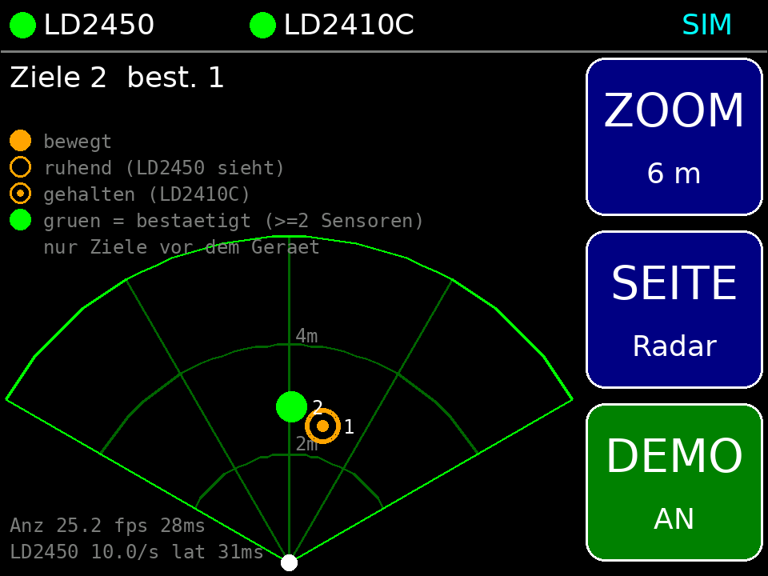
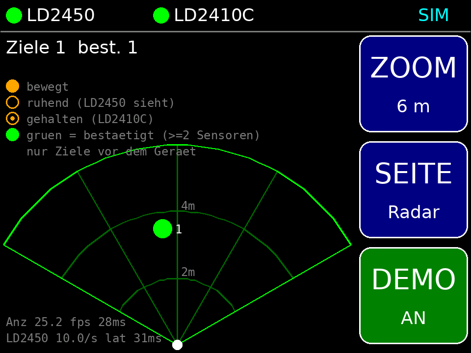
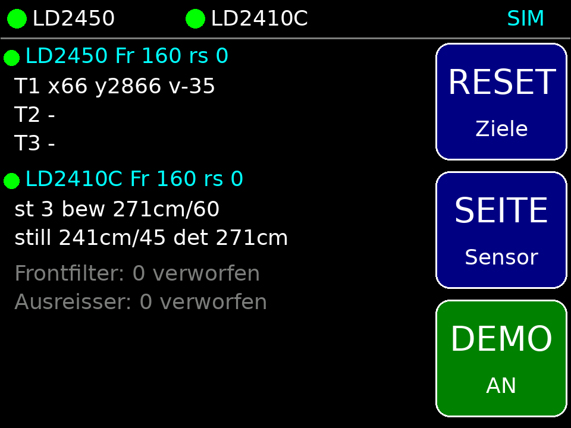
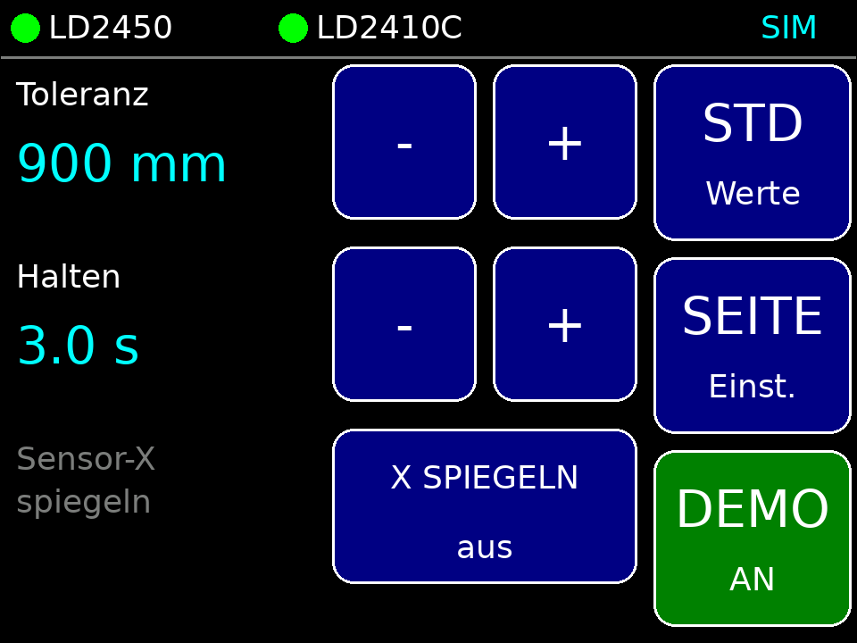
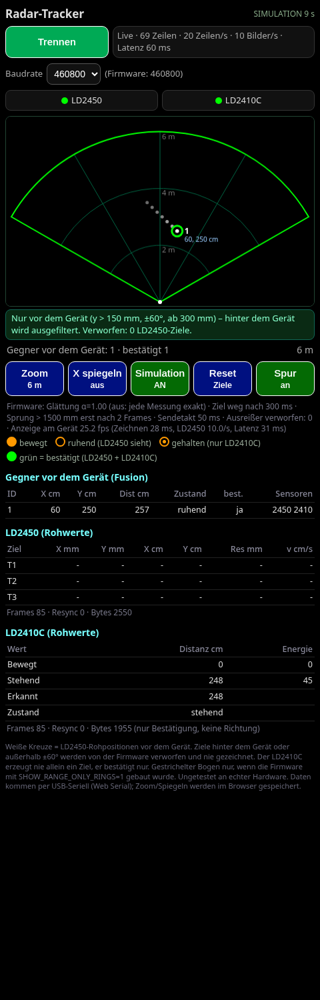

# CYD Radar Tracker 📡

ESP32 firmware that turns the **"Cheap Yellow Display" (CYD, ESP32-2432S028R)** into a live **mmWave radar person tracker**. It fuses an **HLK-LD2450** (multi-target X/Y tracking) with an **HLK-LD2410C** (presence / static-target confirmation), with optional **LD2420** support, and draws the targets in real time on the 320×240 touch display. A browser-based **Web Serial viewer** shows the same data on a PC.

> 🤖 **Built with AI-assisted development (vibe coding).** I designed the features, tested them and iterated on the result; most of the code was written together with an AI coding assistant.

## Screenshots

   



Wiring: [`docs/CYD-Verkabelung.png`](docs/CYD-Verkabelung.png)

## Features

- 🎯 Sensor fusion: LD2450 positions, confirmed/held by LD2410C presence for static people; only targets **in front of** the device
- ⚡ Low latency: every LD2450 frame (~10 Hz) is drawn immediately, no smoothing/prediction; outliers rejected by plausibility (jump gate + 2-frame confirmation)
- 🖥️ Partial redraw with 8-bit sprites for ≥ 20 FPS on the ILI9341 display, on-device FPS/latency readout
- 👆 Touch UI: zoom (3 m / 6 m), mirror X, detail page, settings, demo simulation mode
- 🔌 JSON stream at 20 Hz over USB serial (460800 baud) → **Web Serial viewer** (`firmware/viewer/`, Chrome/Edge) with radar view, tables, optional trail
- 📶 No Wi-Fi, no passwords – works fully offline
- 🧪 Host-side unit tests for the protocol parsers, fusion and JSON output (`firmware/test/`), headless-browser viewer test

## Hardware

| Part | Connection (CYD) |
|---|---|
| ESP32-2432S028R ("CYD") | – |
| HLK-LD2450 | TX → IO22, 5 V, GND (256000 baud) |
| HLK-LD2410C | TX → IO27, 5 V, GND (256000 baud) |
| HLK-LD2420 (optional, `-DENABLE_LD2420=1`) | OT2 → IO35, 3.3 V, GND (115200 baud) |

See [`firmware/include/config.h`](firmware/include/config.h) for pins and tuning parameters (latency, outlier gates, JSON rate, UI timings).

## Build & flash

```bash
pip install platformio
cd firmware
pio run -e cyd-tracker -t upload     # build + flash
pio device monitor -b 460800         # raw JSON stream
```

PC viewer: open `firmware/viewer/` via `python3 -m http.server 8000` (or `start-viewer.bat` on Windows), then visit `http://localhost:8000` in Chrome/Edge and click **Verbinden** (connect).

Host tests: `firmware/test/run_host_test.sh` and `firmware/test/run_json_test.sh` (need `g++`).

Detailed German notes: [`docs/README_DE.md`](docs/README_DE.md)

## Tech stack

C++ (Arduino framework, PlatformIO, ESP32) · TFT_eSPI · XPT2046 touch · UART binary protocols · HTML/JavaScript Web Serial API · Python (test tooling)

## License

[MIT](LICENSE) © 2026 Bartuan3600
